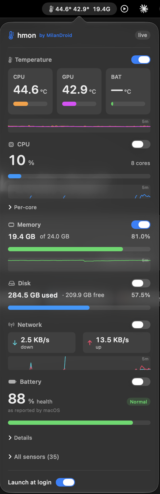
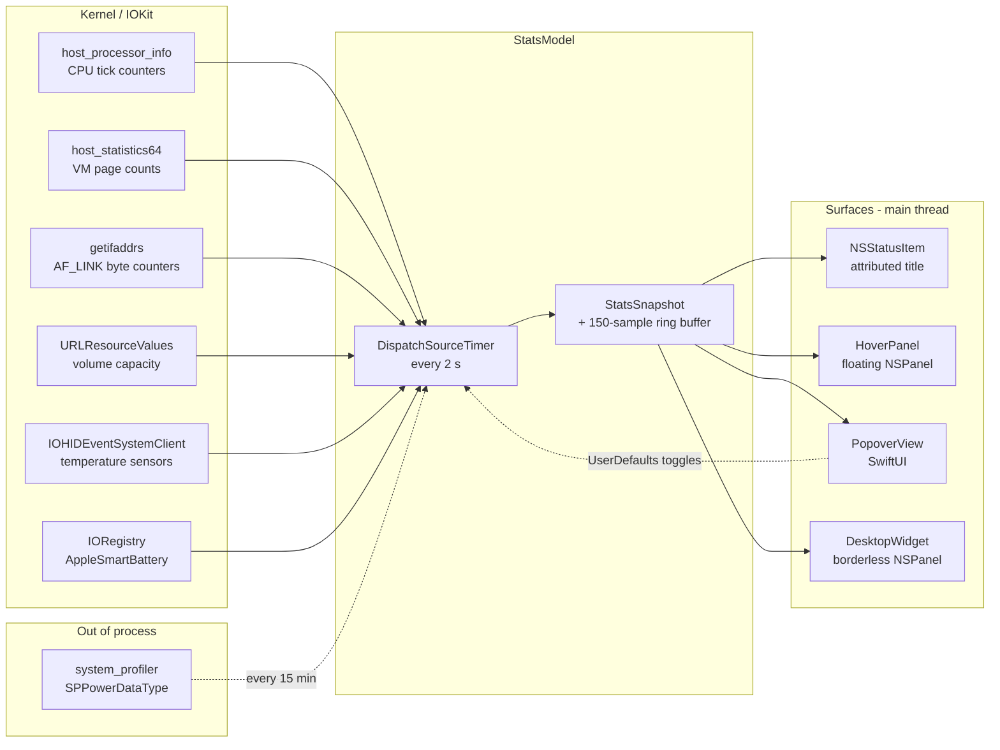
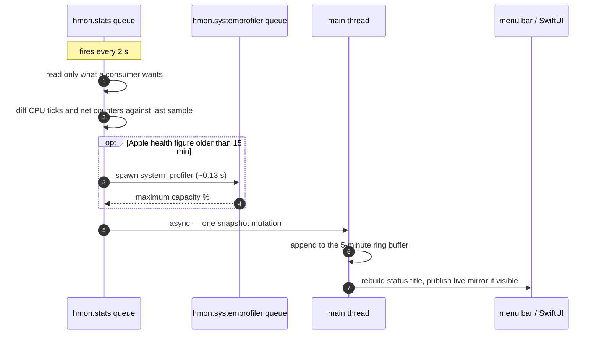
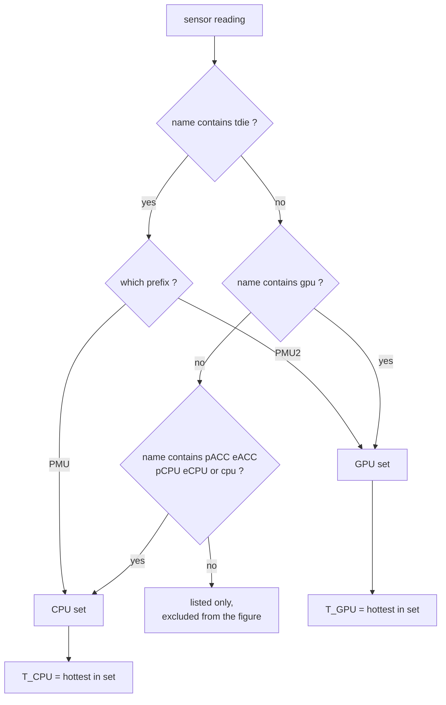

<div align="center">

# 🌡️ hmon

**A featherweight macOS menu bar monitor for Apple Silicon.**

Live die temperatures, per-core CPU load, memory, disk, network and the raw
numbers behind battery health — in a status item that costs you a couple of
milliseconds every two seconds.

<br/>


</div>

<!--
  Screenshots go here. Suggested: docs/menubar.png, docs/popover.png, docs/widget.png
  <p align="center"></p>
-->

---

## Contents

| Section | |
|:--|:--|
| [What it shows](#what-it-shows) | The menu bar title, decoded |
| [Install](#install) | `make install` and you're done |
| [Using it](#using-it) | Popover, hover panel, desktop widget |
| [Architecture](#architecture) | Where every number comes from |
| [The math](#the-math) | Exact formulas, per metric |
| [Sampling budget](#sampling-budget) | What is polled, and how often |
| [Battery health](#battery-health-and-why-it-disagrees-with-system-settings) | Why Apple's number differs from the raw ratio |
| [Troubleshooting](#troubleshooting) | The four things that actually go wrong |
| [Project layout](#project-layout) | File-by-file map |
| [Status](#status) | What is and isn't finished |

---

## What it shows

Everything in the status item is optional and independently toggleable. With
all six segments on, the title reads:

```
 ┌─ SF Symbol "thermometer.medium"
 │
 T   52.3° 41.8°    14%    11.2G    238G    BAT 88%    ↓12.4K ↑1.1K
     └────┬────┘    └┬┘    └─┬─┘    └┬─┘    └──┬──┘    └────┬─────┘
      CPU / GPU     CPU     RAM    disk     battery    net in/out
      die temp     busy    used    free     health        KB/s
```

| Segment | Source | Notes |
|:--|:--|:--|
| 🌡️ **Temperature** | `IOHIDEventSystemClient` | Hottest CPU-side and GPU-side die sensor |
| 🧠 **CPU** | `host_processor_info` | Mean busy % across all logical cores |
| 🧩 **Memory** | `host_statistics64` | Activity Monitor's "Memory Used" convention |
| 💾 **Disk** | `URLResourceValues` | Purgeable-aware free space, decimal GB (Finder's convention) |
| 🔋 **Battery** | `AppleSmartBattery` + `system_profiler` | Maximum-capacity health, plus every input behind it |
| 🌐 **Network** | `getifaddrs` | Physical interfaces only — no loopback, VPN or AWDL |

Every section also keeps a **five-minute sparkline** (150 samples at the 2 s
tick) rendered on a SwiftUI `Canvas`.

---

## Install

**Requirements** — macOS 13 Ventura or later, a Swift 5.9 toolchain (Xcode 15
Command Line Tools), and Apple Silicon for the thermal sensors.

```bash
git clone https://github.com/MilanDroid/hmon.git
```

```bash
cd hmon && make install
```

`make install` builds in release mode, assembles a proper `.app` bundle,
ad-hoc signs it (required for `SMAppService`), copies it to `~/Applications`
and launches it. There is no dock icon — `LSUIElement` is set, so look to the
**right side of the menu bar**.

### All make targets

| Target | What it does |
|:--|:--|
| `make build` | `swift build -c release` — bare binary, no bundle |
| `make app` | Builds and assembles `.build/release/hmon.app`, ad-hoc signed |
| `make run` | Builds and launches straight from `.build` (no install) |
| `make install` | Bundles → `~/Applications/hmon.app` → launches |
| `make uninstall` | Unregisters the login item, removes the app, prefs and caches |
| `make clean` | `swift package clean` and deletes `.build` |

> [!IMPORTANT]
> **Launch at login only works from an installed bundle.** `SMAppService`
> registers a bundle identifier, not a binary, so a raw `swift run` executable
> cannot enable it. Use `make install`.

---

## Using it

### The status item

**Click** it to open the popover. **Hover** it for a floating panel that shows
*every* metric — including the ones you've turned off in the menu bar — and
stays up for four seconds after the cursor leaves, so multi-line text is
actually readable. Clicking anywhere outside the popover dismisses it.

### The popover

Each section header carries a mini switch on its right. That switch controls
**menu bar visibility**, not the section itself — the popover always shows
everything.

Three sections expand for more detail:

- **CPU → Per-core** — a two-column grid of per-core busy bars plus an
  overlaid per-core sparkline. Cores are tinted by index (cooler hues at the
  low end, where Apple Silicon usually parks its E-cores).
- **Battery → Details** — every gauge field: capacities in mAh, cycles,
  voltage, amperage, instantaneous watts, pack temperature, time to full/empty.
- **All sensors (n)** — the complete raw sensor list, each row badged
  <kbd>C</kbd> or <kbd>G</kbd> by silicon family.

Turning a section **off** does more than hide it: while the popover and widget
are both closed, hmon stops *collecting* that metric entirely. An hmon showing
only temperature does strictly less work than one showing all six.

### Launch at login

The toggle at the bottom of the popover. To unregister it from the command
line — which `make uninstall` does for you:

```bash
~/Applications/hmon.app/Contents/MacOS/hmon --disable-login
```

### Desktop widget

A borderless, drag-anywhere floating panel that hosts the same SwiftUI view,
visible on all Spaces and pinned above normal windows. It is a real `NSPanel`
rather than a WidgetKit widget on purpose: WidgetKit timelines refresh at
~15-minute granularity and run out of process, which is irreconcilable with a
2-second sensor poll.

Its toggle is currently commented out in the popover, so enable it through
defaults and relaunch:

```bash
defaults write com.antony.hmon desktopWidget -bool true
```

Its position is remembered across launches. Clicking **Quit** inside the widget
closes the widget only — it will not terminate the app.

---

## Architecture

One timer, one snapshot, four surfaces. Nothing polls anything on its own.



### One tick, in detail

Two background queues; the main thread only ever receives finished values.



The `snapshot` property is a plain `var`, deliberately not `@Published`: the
menu bar redraws twice a second and has no business dragging SwiftUI through a
body re-evaluation. A separate `@Published live` mirror is assigned **only**
while the popover or widget is actually on screen.

---

## The math

Every number below is computed in `SystemStats.swift`, `Sensors.swift` or
`Battery.swift`. No shelling out except for one battery field.

### CPU load

`host_processor_info(PROCESSOR_CPU_LOAD_INFO)` returns monotonically-increasing
scheduler tick counters per logical core. Utilization is the ratio of busy
ticks to total ticks *between two samples*, never an absolute reading:

$$
\Delta b_i = \Delta u_i + \Delta s_i + \Delta n_i
\qquad
U_i = \frac{\Delta b_i}{\Delta b_i + \Delta d_i} \times 100
$$

$$
U_{\text{total}} = \frac{1}{N}\sum_{i=1}^{N} U_i
$$

where $u, s, n, d$ are the user, system, nice and idle counters and $N$ is the
logical core count. Note that $U_{\text{total}}$ is an **unweighted mean over
cores** — an idle E-core pulls the average down exactly as hard as a saturated
P-core pushes it up. All deltas use wrapping subtraction, so a 32-bit counter
rollover produces a correct delta rather than a spike.

### Memory

Mirrors Activity Monitor's *Memory Used* — total minus what is genuinely
reclaimable, with $P$ the kernel page size:

$$
M_{\text{used}} = \max\bigl(0,\ M_{\text{total}} - P\,(n_{\text{free}} + n_{\text{spec}} + n_{\text{ext}})\bigr)
$$

$M_{\text{total}}$ comes from `sysctl hw.memsize`; the page counts come from
`host_statistics64(HOST_VM_INFO64)`. The `external` count is the file-backed
reusable pages Activity Monitor labels *Cached Files*. Reported in binary GB
($2^{30}$ bytes), the convention macOS uses for RAM.

### Disk

Reported in **decimal** GB ($10^9$ bytes) with purgeable-aware free space —
both Finder conventions, so hmon and the Finder info window agree:

$$
F = \frac{\text{available for important usage}}{10^9}
\qquad
D_{\text{used}} = \frac{C_{\text{total}}}{10^9} - F
$$

If the resource-value lookup fails, it falls back to `statfs` and `f_bavail`,
which does *not* count purgeable space and will read lower.

### Network throughput

Byte counters are summed across physical `AF_LINK` interfaces, then
differentiated:

$$
R_{\downarrow} = \frac{\Delta\,\text{ibytes}}{1024\,\Delta t}
\qquad
R_{\uparrow} = \frac{\Delta\,\text{obytes}}{1024\,\Delta t}
\qquad \text{[KB/s]}
$$

Interfaces prefixed `lo`, `gif`, `stf`, `utun`, `awdl`, `llw`, `anpi`, `ap` and
`bridge` are excluded, so VPN tunnels and AirDrop links do not double-count
traffic that already crossed a physical NIC. $\Delta t$ is measured, not
assumed to be 2 s, so a tick delayed by system sleep still yields a correct
rate. Results are clamped at zero and the counter delta wraps safely.

### Temperature

Apple Silicon publishes die temperatures through the private
`IOHIDEventSystemClient` API — resolved at runtime with `dlsym`, so the binary
still links cleanly against public IOKit. hmon matches HID page `0xFF00`,
usage `0x0005`, then classifies by sensor name:



$$
T_{\text{CPU}} = \max_{s \in S_{\text{CPU}}} t_s
\qquad
T_{\text{GPU}} = \max_{s \in S_{\text{GPU}}} t_s
$$

Two naming conventions exist in the wild. M1-generation chips use explicit
names (`pACC MTR`, `GPU MTR`, `ANE MTR`); M2 and later expose power-management
probes (`PMU tdie1`, `PMU2 tcal`). On dual-PMU parts the convention is
`PMU` = main SoC, `PMU2` = the GPU power island.

Calibration probes (`tcal`) and board-level device temps (`tdev`) are
deliberately **excluded from the maximum** — they are not die temperatures —
but still appear in the full sensor list. If nothing matches at all (an
unfamiliar chip), hmon falls back to the single hottest reading and labels it
CPU rather than showing nothing.

Readings outside $(0, 150)\,^\circ\mathrm{C}$ are discarded as gauge noise.

### Battery

Three figures, all of them shown, because they legitimately disagree:

$$
H_{\text{raw}} = \frac{\text{NominalChargeCapacity}}{\text{DesignCapacity}} \times 100
\qquad
H_{\text{gauge}} = \frac{\text{AppleRawMaxCapacity}}{\text{DesignCapacity}} \times 100
$$

$$
H_{\text{shown}} =
\begin{cases}
H_{\text{Apple}} & \text{when the profiler fetch has landed} \\
H_{\text{raw}}   & \text{otherwise}
\end{cases}
$$

Instantaneous pack power, with $V$ in volts and $I$ in mA (negative while
discharging, so $P < 0$ means the battery is supplying the machine):

$$
P = V \cdot \frac{I}{1000} \qquad \text{[W]}
\qquad\qquad
\text{cycle use} = \frac{\text{CycleCount}}{\text{DesignCycleCount9C}} \times 100
$$

**Condition** mirrors System Information: *Service Recommended* when the gauge
raises `PermanentFailureStatus`, or when health drops below Apple's 80 %
service threshold. Otherwise *Normal*.

---

## Sampling budget

The tick is fixed at 2 s. What runs *inside* a tick is not — a source is read
only if some consumer wants it, and the expensive ones back off when nothing
is on screen.

$$
\Delta t = 2\ \text{s}
\qquad
\text{history} = 150\ \text{samples} \times 2\ \text{s} = 5\ \text{min}
$$

| Source | Menu bar only | Popover / widget open | Cost per call |
|:--|:--:|:--:|:--|
| CPU tick counters | 2 s | 2 s | negligible |
| VM page statistics | 2 s | 2 s | negligible |
| Interface byte counters | 2 s | 2 s | negligible |
| Volume capacity | 10 s | 10 s | filesystem round trip |
| `AppleSmartBattery` IORegistry | 10 s | 2 s | ~0.4 ms |
| **HID temperature sensors** | **4 s** | 2 s | most expensive call here |
| Full sensor list | *not read* | 2 s | same enumeration |
| `system_profiler SPPowerDataType` | ≥ 15 min | ≥ 15 min | ~0.13 s, separate process |

Two rules do the heavy lifting:

1. **Off means off.** A metric whose menu bar toggle is disabled is not
   collected while the popover and widget are closed — and its delta baseline
   is reset, so re-enabling it never produces a phantom spike from a stale
   counter.
2. **Nothing slow runs on the tick.** The `system_profiler` spawn lives on its
   own queue with a 15-minute floor. Battery wear is a multi-day process;
   asking more often would be launching processes for nothing.

---

## Battery health, and why it disagrees with System Settings

The number in System Settings is **not** `NominalChargeCapacity / DesignCapacity`.
macOS computes it with `IOPSCopyPowerSourcesByTypePrecise` and smooths the
result, so the live ratio typically reads a point or two lower.

That call is gated behind the private
`com.apple.private.iokit.batterydataprecise` entitlement — verified with
`codesign -d --entitlements`, and calling it unentitled returns
`kIOReturnNotPrivileged`. Apple grants such entitlements only to its own signed
binaries, so **no third-party app can read the value directly.**

`/usr/sbin/system_profiler` does hold that entitlement. So hmon asks it, on a
15-minute cadence, on its own queue — and labels the result honestly:

- The headline percentage is captioned **"as reported by macOS"** when the
  profiler answered, or **"full-charge / design capacity"** when it did not.
- The raw division is shown separately, as `4382 / 4790 = 91.5%`, so the
  arithmetic on screen always agrees with itself.

The two numbers differing is expected behaviour, not a bug — which is exactly
why hmon shows both instead of picking one and hoping.

---

## Troubleshooting

<details>
<summary><b>Temperatures show <code>--°</code></b></summary>
<br/>

The HID temperature page is an Apple Silicon feature; Intel Macs expose thermal
data through SMC keys that hmon does not read. On Apple Silicon, check the dump
hmon writes about a second after launch:

```bash
cat /tmp/hmon-sensors.txt
```

An empty file means the HID client found no matching services. A populated file
whose names match none of the patterns above means an unfamiliar chip — hmon
will fall back to the hottest single reading, and the names in that file are
exactly what a classifier fix would need.
</details>

<details>
<summary><b>"Launch at login" flips back off</b></summary>
<br/>

`SMAppService.mainApp` needs a real, code-signed `.app` bundle. Launch the
installed copy in `~/Applications` — `make install` does the ad-hoc signing —
not a bare `swift build` binary. If System Settings → General → Login Items
still lists a stale entry after `make uninstall`, remove it there by hand.
</details>

<details>
<summary><b>Battery health doesn't match System Settings</b></summary>
<br/>

Expected — see [above](#battery-health-and-why-it-disagrees-with-system-settings).
If the headline says *"full-charge / design capacity"*, the `system_profiler`
fetch hasn't landed yet; give it a moment. It retries on the next tick after
the 15-minute cache expires.
</details>

<details>
<summary><b>Nothing appears in the menu bar</b></summary>
<br/>

hmon is an `LSUIElement` app — no dock icon, no app switcher entry, status item
only. On a notched display a long title can be pushed off-screen entirely: turn
segments off from the popover, or launch it with fewer enabled. With every
segment disabled the item collapses to a thermometer glyph and the word `hmon`.
</details>

---

## Project layout

```
Sources/hmon/
├── main.swift           # Entry point; handles --disable-login and exits
├── AppDelegate.swift    # Status item, popover hosting, HoverPanel
├── StatsModel.swift     # The 2 s tick, adaptive sampling, ring buffer, Prefs
├── SystemStats.swift    # CPU / memory / disk / network — pure functions
├── Sensors.swift        # IOHIDEventSystemClient bridge + name classifier
├── Battery.swift        # AppleSmartBattery reader + system_profiler fallback
├── PopoverView.swift    # The whole SwiftUI UI, including the Sparkline canvas
├── DesktopWidget.swift  # Borderless floating NSPanel hosting the same view
└── LaunchAtLogin.swift  # SMAppService wrapper
Resources/Info.plist     # LSUIElement, bundle id com.antony.hmon
Makefile                 # build · app · run · install · uninstall · clean
```

**Zero third-party dependencies.** `Package.swift` links only AppKit, SwiftUI,
IOKit, ServiceManagement and Foundation.

---

## Status

Version **0.1.0**. Honest state of things:

- **No automated tests.** There is no test target. Every metric above is
  checked by eye against Activity Monitor, Finder and System Information —
  nothing is asserted in CI.
- **No CI, no notarization.** `make app` ad-hoc signs the bundle, which is
  enough for `SMAppService` locally but not for distributing to other Macs.
- **Apple Silicon only** for temperatures. Everything else — CPU, memory, disk,
  network, battery — works on Intel Macs too.
- **The desktop widget toggle is commented out** in `PopoverView.swift`; the
  feature works and is reachable only through the `desktopWidget` default.
- **No LICENSE file yet.** Add one before publishing if this is going public.

---

<div align="center">

Built by **[MilanDroid](http://milandroid.dev/)** · Swift 5.9 · AppKit + SwiftUI

</div>
